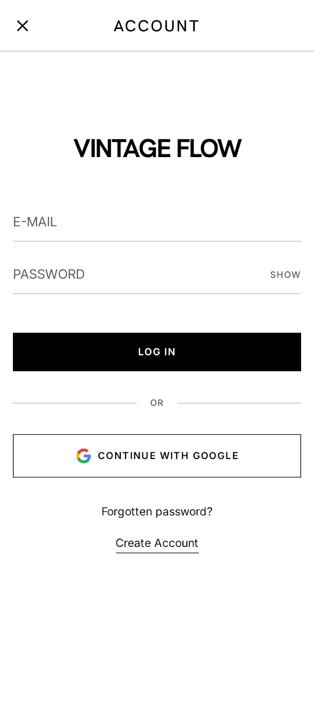
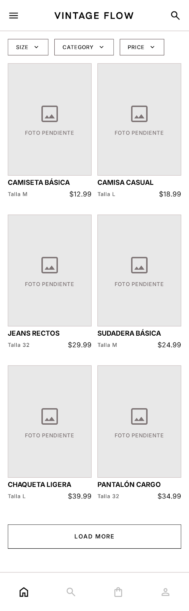
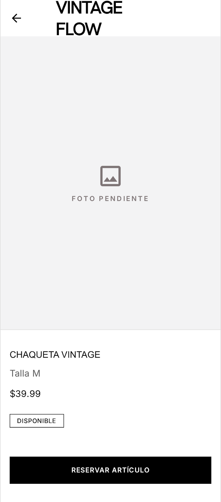
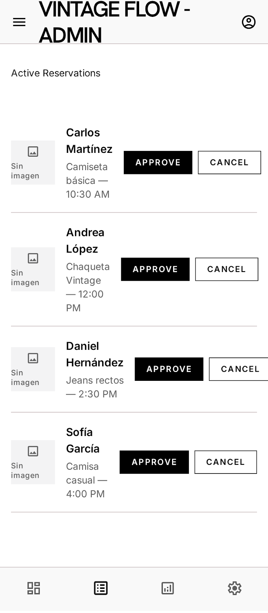
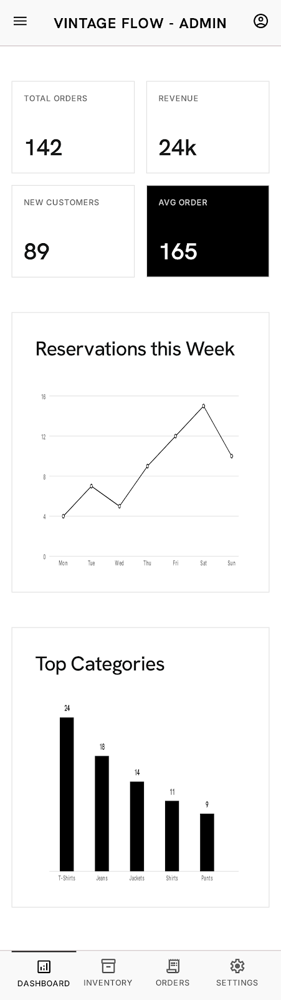
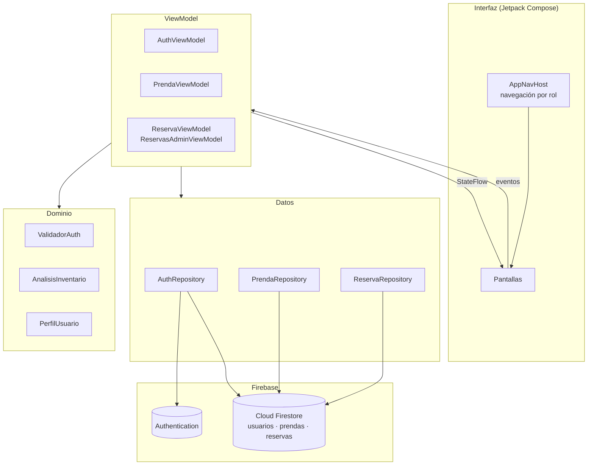

# Vintage Flow

Aplicación Android de catálogo e inventario para **Vintage Flow**, un emprendimiento salvadoreño de ropa de segunda mano. Los clientes consultan las prendas disponibles y las reservan desde la app; el administrador gestiona el inventario, aprueba o cancela las reservas y consulta estadísticas. La venta y la entrega se acuerdan fuera de la aplicación.

Proyecto de la asignatura **Desarrollo de Software para Móviles (DSM941 G02T)**, Universidad Don Bosco. Docente: Ing. Carlos Emanuel Dubón Cornejo.

[](https://creativecommons.org/licenses/by-nc-sa/4.0/deed.es)


## Contenido

- [Funcionalidades](#funcionalidades)
- [Mockups](#mockups)
- [Arquitectura](#arquitectura)
- [Tecnologías](#tecnologías)
- [Estructura del proyecto](#estructura-del-proyecto)
- [Instalación y ejecución](#instalación-y-ejecución)
- [Seguridad en Firestore](#seguridad-en-firestore)
- [Pruebas](#pruebas)
- [Equipo y ramas](#equipo-y-ramas)
- [Licencia](#licencia)

## Funcionalidades

**Autenticación (Firebase Authentication)**

- Registro e inicio de sesión con correo y contraseña.
- Inicio de sesión con Google mediante Credential Manager.
- Recuperación de contraseña por correo.
- Validación de datos antes de llamar a Firebase y mensajes de error claros.

**Cliente**

- Catálogo de prendas actualizado en tiempo real, con estados de carga, error y reintento.
- Detalle de cada prenda y botón **Reservar artículo**.
- **Mis reservas**: historial propio con el estado de cada reserva (pendiente, aprobada o cancelada) y opción de cancelar las pendientes.

**Administrador**

- **Dashboard de estadísticas**: valor total y disponible del inventario, precio promedio, porcentaje vendido, distribución por estado, talla y categoría, y prenda de mayor valor.
- **Inventario**: agregar, editar y eliminar prendas, con validación de campos, precio e identificador duplicado.
- **Panel de reservas**: aprobar o cancelar las reservas de todos los clientes.

**Reglas del negocio**

- Cada prenda es única: la reserva se hace en una transacción de Firestore, así que dos clientes no pueden reservar la misma prenda.
- La prenda pasa por los estados `DISPONIBLE → RESERVADO → VENDIDO`, o vuelve a `DISPONIBLE` si la reserva se cancela.
- Cada perfil solo accede a sus pantallas; las reglas de seguridad de Firestore aplican la misma restricción en el servidor.

## Mockups

Diseño en Figma: [ver archivo de mockups](https://www.figma.com/design/NcXpIhNQKANbb5NLGYI6IB/Sin-t%C3%ADtulo?node-id=0-1&t=wLL098E0cV29tCyg-1)

| Inicio de sesión | Catálogo | Detalle de la prenda |
|:---:|:---:|:---:|
|  |  |  |

| Gestión de reservas (administrador) | Estadísticas (administrador) |
|:---:|:---:|
|  |  |

## Arquitectura

La app sigue el patrón **MVVM** con repositorios. Las pantallas de Compose solo muestran el estado que exponen los ViewModel; los ViewModel dependen de interfaces de repositorio y no de Firebase, lo que permite probarlos con una implementación local.



- **Tiempo real:** los repositorios convierten los listeners de Firestore en `Flow` con `callbackFlow`; los ViewModel los exponen como `StateFlow` y Compose redibuja al cambiar los datos.
- **Concurrencia:** reservar, aprobar y cancelar usan `runTransaction`, que vuelve a leer la prenda y falla si ya no está disponible.
- **Errores:** las operaciones devuelven `Result`, y la interfaz muestra el mensaje en un Snackbar o con un botón de reintento.

## Tecnologías

| Área | Tecnología |
|---|---|
| Lenguaje | Kotlin 2.2 |
| Interfaz | Jetpack Compose, Material 3, Navigation Compose |
| Estado | ViewModel, StateFlow, corrutinas |
| Autenticación | Firebase Authentication, Credential Manager (Google) |
| Base de datos | Cloud Firestore |
| Pruebas | JUnit 4, kotlinx-coroutines-test |
| Android | minSdk 24 · targetSdk 37 |

## Estructura del proyecto

```
app/src/main/java/com/vintageflow/app/
├── data/
│   ├── model/          Prenda, Reserva, estados
│   └── repository/     Interfaces e implementaciones (Firebase y local)
├── domain/             ValidadorAuth, AnalisisInventario, PerfilUsuario, errores
└── ui/
    ├── auth/           Login, registro, recuperación, cliente de Google
    ├── catalog/        Catálogo, detalle y formulario de prendas
    ├── misreservas/    Historial de reservas del cliente
    ├── reservas/       Panel de reservas del administrador
    ├── stats/          Dashboard de estadísticas
    ├── navigation/     Rutas, navegación por rol y barras inferiores
    ├── viewmodel/      ViewModel y sus factories
    └── theme/          Colores, tipografía y tema
firestore.rules         Reglas de seguridad de Cloud Firestore
docs/mockups/           Mockups exportados desde Figma
```

## Instalación y ejecución

**Requisitos:** Android Studio reciente, JDK 17 o superior y un emulador o dispositivo con Android 7.0 (API 24) o más. Para el acceso con Google, el emulador debe incluir Google Play.

1. Clona el repositorio:
   ```bash
   git clone https://github.com/David727-jpg/Grupo-B-VintageFlow-Android.git
   ```
2. En la [consola de Firebase](https://console.firebase.google.com/), crea un proyecto (o usa el del equipo) y registra una app Android con el paquete `com.vintageflow.app`.
3. En **Authentication**, habilita los proveedores **Correo electrónico/contraseña** y **Google**.
4. Registra la huella **SHA-1** de tu certificado de depuración en la configuración de la app de Firebase. Para obtenerla:
   ```bash
   ./gradlew signingReport
   ```
5. Descarga `google-services.json` **después** de registrar la SHA-1 y colócalo en la carpeta `app/`. El archivo no se sube al repositorio.
6. Crea la base de datos de **Cloud Firestore** y publica las reglas de `firestore.rules` (desde la consola o con `firebase deploy --only firestore:rules`).
7. Abre el proyecto en Android Studio, sincroniza Gradle y ejecuta la app.

**Crear un administrador:** toda cuenta nueva se registra como `CLIENTE`. Para tener un administrador, cambia a mano el campo `rol` a `ADMINISTRADOR` en el documento del usuario, dentro de la colección `usuarios` en la consola de Firestore.

> Si la compilación falla con `Unresolved reference 'default_web_client_id'`, el `google-services.json` se descargó sin el cliente web de Google: registra la SHA-1, habilita Google en Authentication y vuelve a descargar el archivo.

## Seguridad en Firestore

Las reglas de `firestore.rules` se evalúan en el servidor, así que la restricción no depende solo de ocultar botones en la app.

| Colección | Cliente | Administrador |
|---|---|---|
| `usuarios` | Lee y edita su propio documento; se registra solo con rol `CLIENTE` y no puede cambiar su rol | Lee, edita y elimina cualquier perfil, incluido el rol |
| `prendas` | Lee el catálogo; solo cambia el estado al reservar o cancelar su propia reserva | Crea, edita y elimina |
| `reservas` | Crea reservas a su nombre y cancela las suyas pendientes | Lee todas, aprueba y cancela |

## Pruebas

Las pruebas unitarias cubren la lógica que no depende de Android:

| Archivo | Qué prueba |
|---|---|
| `ValidadorAuthTest` | Validación de correo, contraseña, nombre y datos de prendas (17 pruebas) |
| `AnalisisInventarioTest` | Cálculo de los indicadores de estadísticas (10 pruebas) |
| `PrendaViewModelTest` | Estado del ViewModel de prendas con un repositorio de prueba |
| `PrendaRepositoryLocalTest` | Aprobación y rechazo de reservas en el repositorio local |

```bash
./gradlew test
```

## Equipo y ramas

Grupo B. Cada integrante trabaja en su rama y los cambios se integran a `main`.

| Integrante | Carnet | Rama |
|---|---|---|
| Jefrey Gerardo Moreno Gómez | MG252234 | [`Jefrey-Moreno-MG252234`](../../tree/Jefrey-Moreno-MG252234) |
| Vladimir Alexander Ayala Cabrera | AC202262 | [`Vladimir-Ayala-AC202262`](../../tree/Vladimir-Ayala-AC202262) |
| Hilda María Martínez de Reyes | MD243315 | [`Hilda-Martinez-MD243315`](../../tree/Hilda-Martinez-MD243315) |
| José David Carabantes Hernández | CH252330 | [`Jose-Carabantes-CH252330`](../../tree/Jose-Carabantes-CH252330) |
| Dilma Esmeralda Ochoa Ayala | OA252494 | [`Dilma-Ochoa-OA252494`](../../tree/Dilma-Ochoa-OA252494) |

Repositorio de la etapa 2: [Grupo-B-Vintage-Flow-App-DSM](https://github.com/dilma8a/Grupo-B-Vintage-Flow-App-DSM)

## Licencia

Este proyecto se distribuye bajo la licencia [Creative Commons Atribución-NoComercial-CompartirIgual 4.0 Internacional (CC BY-NC-SA 4.0)](https://creativecommons.org/licenses/by-nc-sa/4.0/deed.es). Puedes compartirlo y adaptarlo citando a los autores, sin fines comerciales y bajo la misma licencia. El texto completo está en [LICENSE](LICENSE).
